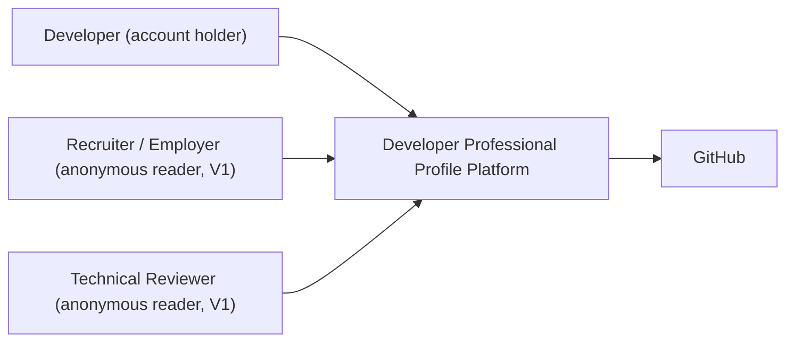
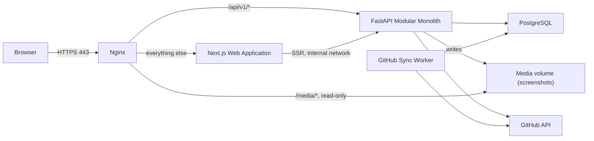

# System Architecture

## 1. Context

Developer Professional Profile Platform is a modular monolith for publishing professional developer profiles with project evidence.

## 2. C4 Context



> **V1 note:** Recruiter / Employer and Technical Reviewer are anonymous readers of public profiles and project pages. They have no account and no V1-specific roles or flows. Recruiter accounts, candidate search and vacancies are V2.

## 3. Container View



The Worker claims queued jobs from PostgreSQL via polling and `SELECT ... FOR UPDATE SKIP LOCKED` — it is not Kafka or an Outbox relay. See docs/release/v1/adr/0008-no-kafka-v1.md and docs/release/v1/adr/0009-sync-worker-skip-locked.md.

Production runs on one host with Docker Compose and one origin (ADR-0021, [0021-single-origin-behind-nginx.md](../release/v1/adr/0021-single-origin-behind-nginx.md)): Nginx terminates TLS and is the only container with public ports (80, 443); PostgreSQL, the API, the frontend and the worker are reachable only on the internal network. Screenshots live in a Docker volume on the host: the API writes them, Nginx serves them under `/media/` from the same origin; there is no S3 or MinIO in V1 (ADR-0022, [0022-media-on-host-volume.md](../release/v1/adr/0022-media-on-host-volume.md)).

## 4. Synchronous flow

Public pages (server rendering):

```text
Browser → Nginx → Next.js → FastAPI (internal network, bypasses Nginx) → PostgreSQL
```

Cabinet and other browser calls (same origin, no CORS in production):

```text
Browser → Nginx (/api/v1/*) → FastAPI → PostgreSQL
```

## 5. Asynchronous GitHub flow

```text
FastAPI
  ↓
PostgreSQL (sync status: NOT_SYNCED -> QUEUED)
  ↓
GitHub Sync Worker (polls github_sync_jobs, claims via SKIP LOCKED)
  ↓
PostgreSQL (sync status: SYNCING -> SYNCED / FAILED)
  ↓
GitHub API
```

GitHub synchronization does not use Kafka or an Outbox pattern in V1. See docs/release/v1/adr/0008-no-kafka-v1.md and docs/release/v1/adr/0009-sync-worker-skip-locked.md.

## 6. Project and Profile lifecycle

Project lifecycle:

```text
DRAFT -> PUBLISHED -> ARCHIVED
```

Project visibility (independent of lifecycle):

```text
PUBLIC
PRIVATE
```

Profile lifecycle:

```text
PRIVATE <-> PUBLISHED
```

Unpublishing a profile returns it to PRIVATE. There is no separate UNPUBLISHED state.

See docs/release/v1/adr/0005-project-lifecycle-visibility.md.

## 7. Architectural constraints

- Modular monolith.
- No microservices in V1.
- No Kafka or Outbox pattern in V1 (see docs/release/v1/adr/0008-no-kafka-v1.md).
- No Redis, Kubernetes or other distributed infrastructure without a separate decision.
- PostgreSQL is the source of truth.
- GitHub data is synchronized and cached rather than fetched from GitHub for every public page.
- GitHub synchronization is asynchronous and idempotent; the worker is a separate process using PostgreSQL polling and `SKIP LOCKED` (ADR-009).
- GitHub Evidence V1 splits into snapshot data (reconciled: upsert + delete-missing) and history data (append-only commits) — see docs/release/v1/adr/0010-github-evidence-model.md.
- Arbitrary code execution is not part of V1.
