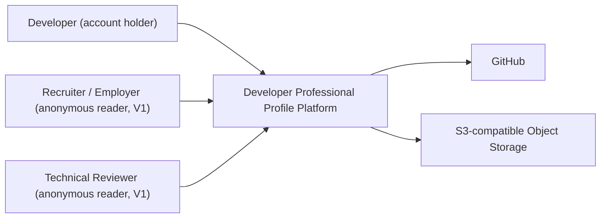
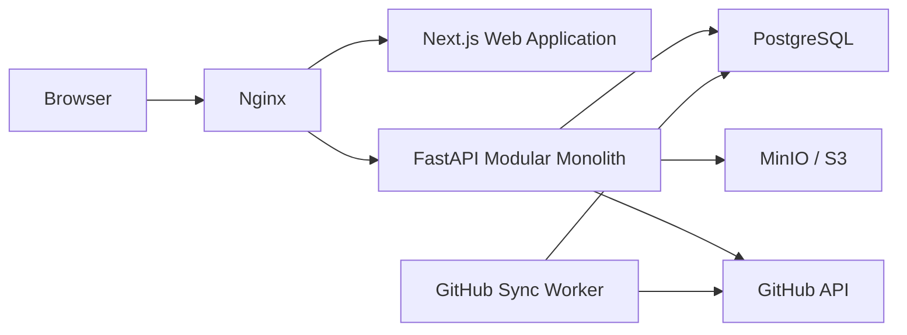

# System Architecture

## 1. Context

Developer Professional Profile Platform is a modular monolith for publishing professional developer profiles with project evidence.

## 2. C4 Context



> **V1 note:** Recruiter / Employer and Technical Reviewer are anonymous readers of public profiles and project pages. They have no account and no V1-specific roles or flows. Recruiter accounts, candidate search and vacancies are V2.

## 3. Container View



The Worker claims queued jobs from PostgreSQL via polling and `SELECT ... FOR UPDATE SKIP LOCKED` — it is not Kafka or an Outbox relay. See ADR-008-no-kafka-outbox-v1.md and ADR-009-github-sync-worker-execution-model.md.

## 4. Synchronous flow

```text
Browser
  ↓
Nginx
  ↓
Next.js
  ↓
FastAPI
  ↓
PostgreSQL
```

Used for normal CRUD operations.

## 5. Asynchronous GitHub flow

```text
FastAPI
  ↓
PostgreSQL (sync status: NOT_SYNCED -> QUEUED)
  ↓
GitHub Sync Worker (polls github_sync_jobs, claims via SKIP LOCKED)
  ↓
PostgreSQL (sync status: SYNCING -> SYNCED / FAILED)
  ↓
GitHub API
```

GitHub synchronization does not use Kafka or an Outbox pattern in V1. See ADR-008-no-kafka-outbox-v1.md and ADR-009-github-sync-worker-execution-model.md.

## 6. Project and Profile lifecycle

Project lifecycle:

```text
DRAFT -> PUBLISHED -> ARCHIVED
```

Project visibility (independent of lifecycle):

```text
PUBLIC
PRIVATE
```

Profile lifecycle:

```text
PRIVATE <-> PUBLISHED
```

Unpublishing a profile returns it to PRIVATE. There is no separate UNPUBLISHED state.

See ADR-005-project-lifecycle-and-visibility.md.

## 7. Architectural constraints

- Modular monolith.
- No microservices in V1.
- No Kafka or Outbox pattern in V1 (see ADR-008-no-kafka-outbox-v1.md).
- No Redis, Kubernetes or other distributed infrastructure without a separate decision.
- PostgreSQL is the source of truth.
- GitHub data is synchronized and cached rather than fetched from GitHub for every public page.
- GitHub synchronization is asynchronous and idempotent; the worker is a separate process using PostgreSQL polling and `SKIP LOCKED` (ADR-009).
- GitHub Evidence V1 splits into snapshot data (reconciled: upsert + delete-missing) and history data (append-only commits) — see ADR-010-github-evidence-data-model-v1.md.
- Arbitrary code execution is not part of V1.
